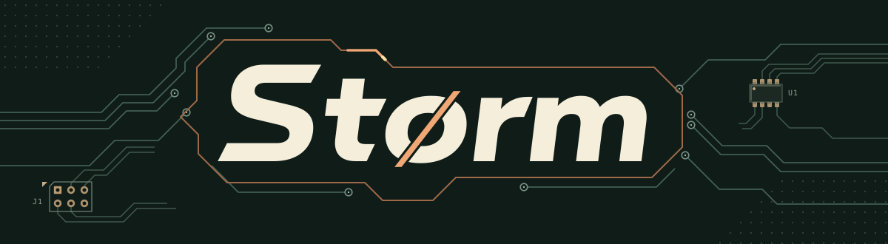
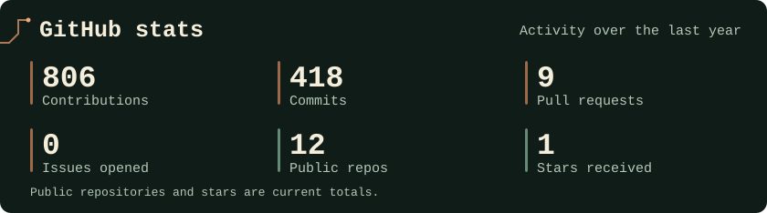
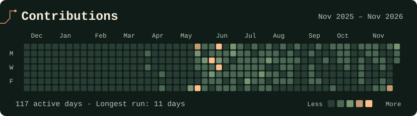
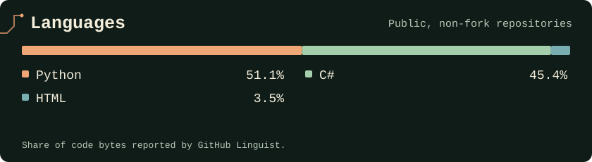

  

  <a href="https://ac-storm.com/"><strong>Portfolio ↗</strong></a> &nbsp; / &nbsp;
  <a href="#projects"><strong>Projects ↓</strong></a> &nbsp; / &nbsp;
  <a href="#github-activity"><strong>Activity ↓</strong></a> &nbsp; / &nbsp;
  <a href="https://discord.com/users/329051281891131393"><strong>Discord ↗</strong></a>

I’m **Størm**. I build desktop tools with **C# and .NET** and work in **IT support**. I like figuring out why something broke and finding a way to automate the fix.

I started coding in **Visual Basic in 2014**, moved to **C# in 2017**, and picked up HTML, CSS, and JavaScript along the way. These days I split my time between building Windows utilities, modding games, and contributing to other developers’ GitHub projects that catch my interest.

## Projects

### [Rocket Swap](https://rocketswap.dev/)

Rocket Swap is my biggest project to date, and our Discord community has grown to **over 14,000 members**.

I built Rocket Swap to manage Rocket League cosmetic mods on Windows. You can import and organize mods, generate local visual swaps, and pick which ones to use before launch. When you close the game, Rocket Swap restores the clean files.

Rocket Swap grew out of two earlier projects.

- **[Alphy](https://github.com/AC-Storm-YT/Alphy-Public)** manages local cosmetic mods, with backups for safer file swaps, custom imports, mod sharing, and plugin support.
- **[Alphy Swapper](https://github.com/AC-Storm-YT/Alphy-Swapper)** is the official plugin that turns supported UPK assets into cosmetic swaps right inside Alphy.

### Windows & networking

**“Why is that security toggle greyed out?”**  
[Windows Security Patcher](https://github.com/AC-Storm-YT/windowssecuritypatcher) repairs two settings that can become inaccessible in Windows 11 — Memory Integrity and Kernel-mode Hardware-enforced Stack Protection.

**“My public IP changed. Can Windows relink NextDNS for me?”**  
[NextDNS Linker](https://github.com/AC-Storm-YT/ndnslinker) validates your linked-IP URL and registers a Windows Task Scheduler entry. When Windows reports a network-profile connection, the task refreshes the link.

## GitHub activity

## What’s on my desk

`C#` · `.NET` · `Visual Studio` · `Windows` · `Git`

I’m digging further into **systems programming** and working on how I structure, test, and maintain my code. I use **Codex through ChatGPT** and **Claude Code** to learn unfamiliar concepts, prototype ideas, chase bugs, and work through complex implementations. I define the behavior, make the technical calls, and test what ships.

<strong>Open the full toolbox</strong>

| Area | Tools |
| --- | --- |
| Apps & scripting | C#, .NET, Visual Basic, Python, Lua, SQL |
| Web | HTML5, CSS, JavaScript |
| Cloud & storage | Cloudflare Workers, KV, R2, D1, Supabase |
| Reverse engineering & analysis | Ghidra, ILSpy, dnSpy |
| Development environment | Visual Studio, Visual Studio Code, Git, GitHub, Windows |
| AI tools | Codex, ChatGPT, Claude, Claude Code, Gemini |

<strong>What I do in IT support</strong>

- **At the workbench** I assemble PCs, install hardware and peripherals, and troubleshoot software and device issues.
- **On Windows** I install, configure, recover, and optimize operating systems, deploy software, and automate tasks with system commands and scripts.
- **On the network** I install and configure local networks, maintain servers and networks, and work with Windows Server, virtualization, and database management fundamentals.
- **With users** I work through problems step by step and support mobile devices and collaboration tools.

  

